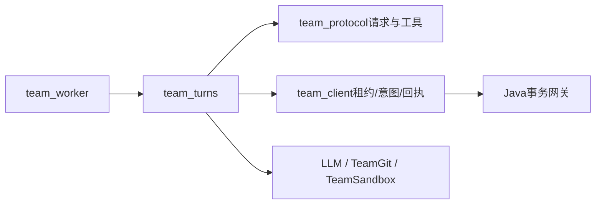

# Python 执行器

旧会话由 `agentd.app.SessionRuntime` 与 `gill_core.loop` 维护。新团队路径独立：

`agentd.app → team_worker → team_turns → team_client / team_protocol / LLM / TeamGit → TeamSandbox / TeamObjects`。

`team_client` 只携带内部服务身份；`team_turns` 管理有效 Prompt、工具调用、检查点与控制；`team_sandbox` 是新运行的 CubeSDK 适配边界，资源 ID 持久化到 Java。模型和沙箱不接触网关/对象存储凭据。旧会话 SDK 适配仍在 `remote_sandbox`。

模型工具`team_message`显式传requiresResponse：工作请求true，进展/收到/结束通知false；后者即使@员工也不派工。`archive_document`映射当前任务项目的文档归档，不授予项目配置或知识写权。`complete_task`可携带`artifact`最终报告：先保存、再请求完成，使用稳定请求标识支持重放；失败保留成果，网关继续拦截暂停/未决/未知动作。旧空参数仍支持已有成果。模型自主选择结束，不按自然语言自动完成。模型预留后读取共享run调用数/上限，资源信息不改变必需流程；收到核查/交接请求需requiresResponse=true，流程要求等人决定必须形成真实问题。实际外部回执与模型判断分开注入。

任务代次与依赖等待由网关校验，Worker按heartbeat停止新调用，在途结果继续回存。



运行环境始终使用项目虚拟环境：

```sh
uv venv .venv
uv pip install --python .venv/bin/python -e '.[server,sandbox]'
.venv/bin/python -m unittest discover -s tests -v
.venv/bin/python -m agentd.app
```

内部队列需要 `GILL_TEAM_WEB_URL`、至少 32 字符的 `GILL_TEAM_WORKER_SECRET`，默认 3 个槽位；缺少服务凭据时停用新 Worker。Compose 已传递这些变量。模型配置包括 `ZHIPU_API_KEY`、`ZHIPU_MODEL`、可选 `ZHIPU_BASE_URL`，使用有合法标准 API 资源的端点。

测试范围及真实模型阻塞见[验证记录](../docs/features/digital-employee-team/verification.md)。细则见 [AGENT.md](AGENT.md)。
