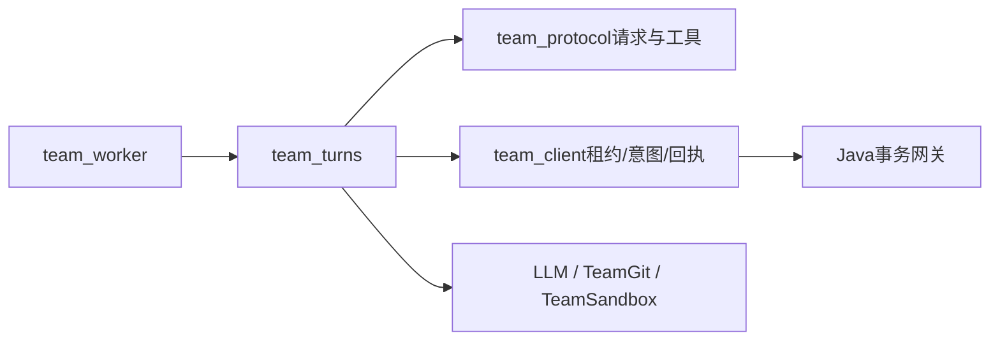

# Python 执行器

旧会话由 `agentd.app.SessionRuntime` 与 `gill_core.loop` 维护。新团队路径独立：

`agentd.app → team_worker → team_turns → team_client / team_protocol / LLM / TeamGit → TeamSandbox / TeamObjects`。

`team_client` 只携带内部服务身份；`team_turns` 管理有效 Prompt、工具调用、检查点与控制；`team_sandbox` 是新运行的 CubeSDK 适配边界，资源 ID 持久化到 Java。模型和沙箱不接触网关/对象存储凭据。旧会话 SDK 适配仍在 `remote_sandbox`。

`team_template_files` 从草稿或任务快照加载对应版本的指令和 Skill。`read_template_file` 按清单路径读取参考文件。需要使用沙箱时，模板目录在 `/tmp/gill-template` 中按原结构展开。

模型用 `notify_team` 发通知和意见、`request_peer_review` 邀请核查、`assign_task` 正式派工。旧员工 `team_message` 聊天请求按通知收件，重放保留原请求参数和标识。用户启用派工审批时，以当前上下文和网关为准，主任务用 `ask_superior(dispatchApproval=true)` 发起许可申请。模型预留后读取共享运行调用数和上限。实际外部回执与模型判断分开注入。

`archive_document` 归档当前关联项目的文档。`complete_task` 可携带 `artifact` 最终报告，以及一项 `assign` 派工或 `review` 核查。执行器依次保存证据、提交交接、提出完成，并使用稳定请求标识支持重放。完成未确认时仍返回已经提交的交接回执。已有合格成果可用空参数提交完成。

任务代次与依赖等待由网关校验，Worker按heartbeat停止新调用，在途结果继续回存。

Worker 在执行模型的一组工具调用前识别同轮上报。依赖派工与完成留待决定，明确提交的新报告仍可先保存。评审回执使用 `reviewId` 并注明被评审的产物及版本，任务上下文显示剩余的共享调用次数。跨轮行为和回归证据见[闭环记录](../docs/features/digital-employee-team/closure_20261118.md)。



运行环境始终使用项目虚拟环境：

```sh
uv venv .venv
uv pip install --python .venv/bin/python -e '.[server,sandbox]'
.venv/bin/python -m unittest discover -s tests -v
.venv/bin/python -m agentd.app
```

内部队列需要 `GILL_TEAM_WEB_URL`、至少 32 字符的 `GILL_TEAM_WORKER_SECRET`，默认 3 个槽位；缺少服务凭据时停用新 Worker。Compose 已传递这些变量。模型配置包括 `ZHIPU_API_KEY`、`ZHIPU_MODEL`、可选 `ZHIPU_BASE_URL`，使用有合法标准 API 资源的端点。

测试范围及真实模型阻塞见[验证记录](../docs/features/digital-employee-team/verification.md)。细则见 [AGENT.md](AGENT.md)。
