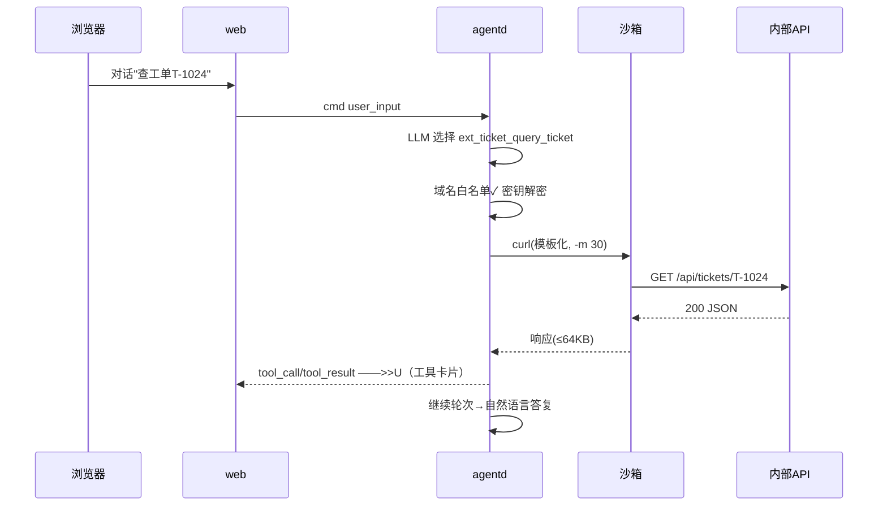
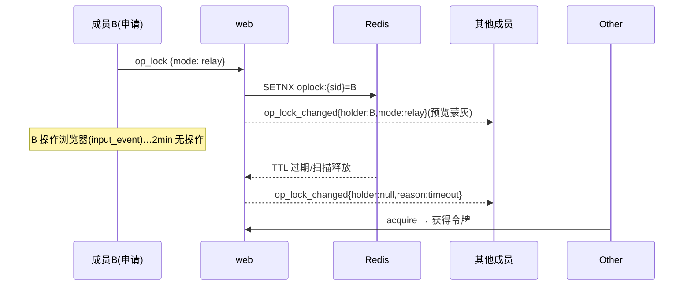

# 低层详细设计文档（LLD） — Gill Agent

| 项 | 内容 |
|---|---|
| 文档版本 | v1.1（对应需求 v1.5 / 架构 v1.3；对齐浏览器全量 E2E 修复 + 前端 Vue 重构后的实际代码） |
| 编写日期 | 2026-10-17（v1.1 修订 2026-10-18） |
| 上游文档 | 《01-需求澄清 v1.5》《02-总体架构与模块设计 v1.3》《03-测试用例设计 v1.2》 |
| 读者/用途 | 开发实施唯一编码依据：目录结构、DDL、API/事件 Schema、模块内部设计、时序与错误矩阵 |

---

## 1. 代码仓库与目录结构

```
gill-agent/
 ├─ docs/                       # 01 需求 / 02 架构 / 03 测试 / 04 本文档 / 05 部署
 ├─ web/                        # Java 21 + Spring Boot 3.3（Maven 单模块）
 │   ├─ pom.xml
 │   ├─ Dockerfile              # 三阶段：node:20 前端构建 → maven 打 jar → JRE 21 运行
 │   ├─ frontend/               # Vue 3 + TypeScript + Vite 5 + Pinia（详见 §9）
 │   │   ├─ package.json / package-lock.json / vite.config.ts / tsconfig*.json / index.html
 │   │   └─ src/{main.ts, App.vue, api.ts, types.ts, styles.css, views/, components/, stores/}
 │   └─ src/main/java/com/gill/web/{controller, ws, security, config}
 │       └─ src/main/resources/{application.yml, migration/}    # Flyway DDL；static/ 为前端构建产物（gitignore）
 ├─ agent/                      # Python 3.12（uv 管理）
 │   ├─ pyproject.toml          # deps: fastapi uvicorn openai e2b(cubesandbox SDK) redis asyncpg minio httpx typer
 │   ├─ gill_core/{config,llm,loop,kb,exts,risk,tools,sandbox,remote_sandbox,browser,files,bus,store}.py
 │   ├─ agentd/app.py           # FastAPI 网关 + SessionRuntime + sweep 孤儿清扫（§6 设计的单文件落地）
 │   ├─ gill_cli/main.py        # typer：chat/run/login/whoami/knowledge/doctor/version
 │   └─ *_e2e.py / *_test.py    # API 级 E2E（remote_smoke_final/file_e2e/perf_test/scale_test/regression_test/four_task_e2e）
 ├─ deploy/
 │   ├─ docker-compose.yml  .env
 │   └─ cube/                   # install-cube.sh（沙箱机一键）/ build-template.sh / gill-agent-sandbox 模板 Dockerfile
 ├─ gui-test-screenshots/       # 浏览器黑盒 E2E 证据（t01-t16 首轮 / r1-r8 回归 / v1-v7 Vue 版）
 └─ scripts/backup.sh           # pg_dump → MinIO gill-backup
```

## 2. 数据库 DDL（Flyway V1__init.sql，完整版）

```sql
CREATE EXTENSION IF NOT EXISTS vector;

CREATE TABLE users (
  id BIGSERIAL PRIMARY KEY, username VARCHAR(32) UNIQUE NOT NULL,
  password_hash VARCHAR(100) NOT NULL, role VARCHAR(8) NOT NULL DEFAULT 'USER',
  status VARCHAR(8) NOT NULL DEFAULT 'ACTIVE',
  custom_instructions VARCHAR(2000),
  storage_quota_bytes BIGINT NOT NULL DEFAULT 5368709120,
  token_quota_daily BIGINT NOT NULL DEFAULT 2000000,
  created_at TIMESTAMPTZ NOT NULL DEFAULT now(), last_login_at TIMESTAMPTZ);

CREATE TABLE spaces (
  id UUID PRIMARY KEY, type VARCHAR(8) NOT NULL,          -- personal|group
  name VARCHAR(64) NOT NULL, owner_user_id BIGINT NOT NULL REFERENCES users(id),
  default_approval VARCHAR(8) NOT NULL DEFAULT 'auto',
  default_op_mode VARCHAR(8) NOT NULL DEFAULT 'free',
  created_at TIMESTAMPTZ NOT NULL DEFAULT now(), dissolved_at TIMESTAMPTZ);

CREATE TABLE space_members (
  space_id UUID REFERENCES spaces(id), user_id BIGINT REFERENCES users(id),
  role VARCHAR(8) NOT NULL DEFAULT 'member', joined_at TIMESTAMPTZ NOT NULL DEFAULT now(),
  PRIMARY KEY (space_id, user_id));

CREATE TABLE invites (
  id UUID PRIMARY KEY, space_id UUID NOT NULL REFERENCES spaces(id),
  token VARCHAR(32) UNIQUE NOT NULL, created_by BIGINT NOT NULL REFERENCES users(id),
  expires_at TIMESTAMPTZ NOT NULL, revoked BOOLEAN NOT NULL DEFAULT false,
  accepted_by BIGINT REFERENCES users(id));

CREATE TABLE space_chat (
  id BIGSERIAL PRIMARY KEY, space_id UUID NOT NULL REFERENCES spaces(id),
  user_id BIGINT NOT NULL REFERENCES users(id), content TEXT NOT NULL,
  created_at TIMESTAMPTZ NOT NULL DEFAULT now());
CREATE INDEX ON space_chat (space_id, created_at DESC);

CREATE TABLE pats (
  id UUID PRIMARY KEY, user_id BIGINT NOT NULL REFERENCES users(id),
  name VARCHAR(64) NOT NULL, token_hash VARCHAR(64) UNIQUE NOT NULL,  -- sha256(gpat_...)
  created_at TIMESTAMPTZ NOT NULL DEFAULT now(), last_used_at TIMESTAMPTZ,
  revoked BOOLEAN NOT NULL DEFAULT false);

CREATE TABLE sessions (
  id UUID PRIMARY KEY, space_id UUID NOT NULL REFERENCES spaces(id),
  user_id BIGINT NOT NULL REFERENCES users(id),           -- 创建者
  title VARCHAR(50), project_tag VARCHAR(50),
  status VARCHAR(12) NOT NULL DEFAULT 'created',          -- created|sandbox_creating|active|idle|closing|closed|error|interrupted|archived
  sandbox_id VARCHAR(64), node_owner VARCHAR(64),
  created_at TIMESTAMPTZ NOT NULL DEFAULT now(),
  last_active_at TIMESTAMPTZ NOT NULL DEFAULT now(), closed_at TIMESTAMPTZ);
CREATE INDEX ON sessions (space_id, status);

CREATE TABLE messages (
  id BIGSERIAL PRIMARY KEY, session_id UUID NOT NULL REFERENCES sessions(id) ON DELETE CASCADE,
  seq INT NOT NULL, role VARCHAR(12) NOT NULL,            -- user|assistant|tool|system|handoff
  content TEXT, actor_user_id BIGINT REFERENCES users(id),
  tool_name VARCHAR(48), tool_args JSONB, tool_result JSONB,
  trace_id VARCHAR(32), created_at TIMESTAMPTZ NOT NULL DEFAULT now(),
  UNIQUE (session_id, seq));

CREATE TABLE command_audit (
  id BIGSERIAL PRIMARY KEY, session_id UUID REFERENCES sessions(id),
  space_id UUID, user_id BIGINT NOT NULL,                 -- actor
  sandbox_id VARCHAR(64), command TEXT NOT NULL,
  risk_level VARCHAR(8), rule_id VARCHAR(8),
  decision VARCHAR(12), decision_by BIGINT,
  exit_code INT, duration_ms INT, created_at TIMESTAMPTZ NOT NULL DEFAULT now());
CREATE INDEX ON command_audit (space_id, created_at DESC);

CREATE TABLE file_objects (
  id UUID PRIMARY KEY, space_id UUID NOT NULL REFERENCES spaces(id),
  user_id BIGINT NOT NULL, session_id UUID,
  direction VARCHAR(8) NOT NULL,                          -- upload|export
  object_key TEXT NOT NULL, filename VARCHAR(255) NOT NULL,
  size_bytes BIGINT NOT NULL, status VARCHAR(10) NOT NULL DEFAULT 'pending',
  created_at TIMESTAMPTZ NOT NULL DEFAULT now(), expired_at TIMESTAMPTZ);
CREATE INDEX ON file_objects (space_id, created_at DESC);

CREATE TABLE knowledge_items (
  id UUID PRIMARY KEY, user_id BIGINT NOT NULL,           -- 创建者
  space_id UUID,                                          -- scope=user 时=个人空间id；group=协作空间id
  scope VARCHAR(8) NOT NULL,                              -- session|project|group|user
  project_tag VARCHAR(50), session_id UUID,
  type VARCHAR(12) NOT NULL,                              -- preference|fact|correction|project|snippet
  title VARCHAR(128) NOT NULL, content TEXT NOT NULL, tags TEXT[] DEFAULT '{}',
  source VARCHAR(8) NOT NULL,                             -- auto|explicit
  source_msg_id BIGINT, embedding vector(1024),
  confidence REAL NOT NULL DEFAULT 0.8, hit_count INT NOT NULL DEFAULT 0,
  last_used_at TIMESTAMPTZ, pinned BOOLEAN NOT NULL DEFAULT false,
  status VARCHAR(8) NOT NULL DEFAULT 'active',
  version INT NOT NULL DEFAULT 1, created_at TIMESTAMPTZ NOT NULL DEFAULT now(),
  updated_at TIMESTAMPTZ NOT NULL DEFAULT now());
CREATE INDEX ON knowledge_items USING hnsw (embedding vector_cosine_ops);
CREATE INDEX ON knowledge_items (space_id, scope, status);

CREATE TABLE extensions (
  id UUID PRIMARY KEY, user_id BIGINT NOT NULL,           -- 安装者
  space_id UUID,                                          -- visibility=space 时归属空间（private 时=个人空间id）
  visibility VARCHAR(8) NOT NULL DEFAULT 'private',
  name VARCHAR(32) NOT NULL, version VARCHAR(16) NOT NULL,
  type VARCHAR(16) NOT NULL,                              -- http-tools|script-tools|skill|mcp|prompt
  manifest JSONB NOT NULL, status VARCHAR(8) NOT NULL DEFAULT 'enabled',
  call_count_7d INT NOT NULL DEFAULT 0,
  created_at TIMESTAMPTZ NOT NULL DEFAULT now(), updated_at TIMESTAMPTZ NOT NULL DEFAULT now(),
  UNIQUE (space_id, name));

CREATE TABLE extension_secrets (
  id UUID PRIMARY KEY, user_id BIGINT NOT NULL,
  name VARCHAR(64) NOT NULL, cipher BYTEA NOT NULL,        -- AES-256-GCM(KB_MASTER_KEY)
  created_at TIMESTAMPTZ NOT NULL DEFAULT now(), UNIQUE (user_id, name));

CREATE TABLE llm_usage (
  id BIGSERIAL PRIMARY KEY, user_id BIGINT NOT NULL, session_id UUID,
  model VARCHAR(32) NOT NULL, prompt_tokens INT NOT NULL, completion_tokens INT NOT NULL,
  created_at TIMESTAMPTZ NOT NULL DEFAULT now());
CREATE INDEX ON llm_usage (user_id, created_at DESC);
-- 定时清理：space_chat>30d；file_objects expired；解散空间 dissolved_at+7d 级联
```

## 3. REST API 全量端点（/api/v1，OpenAPI 同步生成）

| 域 | 端点 | 说明 |
|---|---|---|
| auth | POST /auth/register、/auth/login；GET /me；PATCH /me/password、/me/instructions | JWT；锁定 5/15min |
| pat | GET/POST /me/pats；DELETE /me/pats/{id} | 创建返回明文仅一次 |
| space | GET /spaces（含个人+所属）；POST /spaces；GET/PATCH/DELETE /spaces/{id}；GET /spaces/{id}/members | 解散=级联+宽限 |
| invite | POST /spaces/{id}/invites {username?}；DELETE /invites/{token}；POST /invites/{token}/accept | 直邀即时生效 |
| member | PATCH/DELETE /spaces/{id}/members/{userId} | @SpaceRole(admin+) |
| chat | GET /spaces/{id}/chat?before=；POST /spaces/{id}/chat {content} | @agent 前缀由 web 标记 is_agent_mention |
| session | GET/POST /spaces/{id}/sessions；GET/PATCH/DELETE /sessions/{id}；GET /sessions/{id}/messages?before=&limit= | 创建带 project_tag? |
| ws | GET /ws/agent?sessionId&token（Upgrade） | §4 事件协议 |
| file | POST /sessions/{id}/files/uploads；POST …/uploads/{uid}/complete；POST …/files/sync-in、/exports、file_list(cid 走 WS)、DELETE …/uploads/{uid}；GET /spaces/{id}/files（空间文件库） | 预签名/审计如 01 |
| kb | GET/POST /spaces/{id}/knowledge；PATCH/DELETE /knowledge/{id}；POST /knowledge/{id}/pin；GET /spaces/{id}/knowledge/search?q=；POST /spaces/{id}/knowledge/export、/import | 检索=混合（web 转发 agentd /internal/kb/search） |
| ext | GET/POST /spaces/{id}/extensions；PATCH/DELETE /extensions/{id}；POST /extensions/{id}/publish、/test；GET /extensions/{id}/tools、/calls | manifest 校验在 web（schema）+agentd（运行时）双层 |
| oplock | POST /sessions/{id}/oplock {action: acquire|release} | relay 模式限定 |
| admin | GET /admin/users…；PATCH /admin/users/{id}；GET /admin/users/{id}/sessions；DELETE /admin/sessions/{id}；GET /admin/audit、/admin/audit/export.csv；GET /admin/stats；GET/PATCH /admin/config | 简化后台（D11） |

## 4. WebSocket 事件协议（全量）

信封：`{type, cid?, seq, ts, traceId, actor?, payload}`；二进制帧=投屏 JPEG（前置 screencast_meta 文本帧）。重连：客户端带 `Last-Event-Seq`，服务端从 evt 流按 seq 增量重放（≤1000 条窗口，超出引导 REST 拉历史）。

| 方向 | type | payload |
|---|---|---|
| C→S | user_input | {text, mention?:bool}（@agent 转入） |
| C→S | stop | {} |
| C→S | preview_start/preview_stop | {quality?: high|mid|low} |
| C→S | input_event | {kind, x?, y?, button?, key?, text?}（relay 模式服务端校验 oplock 持有者） |
| C→S | file_sync_in / file_export / file_list / file_delete | {uploadId?, path?…} |
| C→S | approval_response | {cid, action: approve|deny|always_allow} |
| C→S | op_lock | {action: acquire|release|mode, mode?: free|relay} |
| C→S | nav_push | {fileTreePath?, previewUrl?, termScroll?}（演示模式发起者） |
| C→S | typing | {}（节流 3s，仅协作空间转发） |
| S→C | agent_delta / tool_call / tool_result / terminal | 同 02 §3.2 |
| S→C | screencast_meta / (binary) frame | 帧元数据/JPEG |
| S→C | approval_request / approval_timeout | {cid, command, riskLevel, reason, ruleId, expiresIn} |
| S→C | kb_captured | {ids:[…], summary}（轻提示条数据） |
| S→C | file_sync_progress / file_synced / file_exported / file_tree | 同 01 §11.6 |
| S→C | session_status / done / error / pong | {status} / {reason, code} |
| S→C | presence_join / presence_leave | {userId, name, avatarSeed} |
| S→C | op_lock_changed | {holder?, mode, reason: release|timeout|kick} |
| S→C | member_typing | {userId} |
| S→C | nav_follow | {fileTreePath?, previewUrl?, termScroll?}（演示跟随端） |
| S→C | space_chat_msg | {id, userId, name, content, isAgentMention}（侧栏实时） |

## 5. web 模块详细设计（Java，v1.1 对齐实际实现）

### 5.1 线程模型与 WS 网关（AgentWebSocketHandler）

- Tomcat 处理 REST；`AgentWebSocketHandler`（TextWebSocketHandler）承担 WS 网关：
  - `conns: Map<sid, Set<WebSocketSession>>` 同会话多端扇出（发送按 session 串行化）；
  - **SSE 泵生命周期（关键设计，浏览器 E2E 事故固化）**：一会话一泵。泵 = `HttpClient.sendAsync` + `BodyHandlers.ofLines()` 读 agentd `/internal/sessions/{sid}/events`，逐行 `data: ` 前缀转 WS 下发。末连接断开时**必须 `Stream.close()` 关闭 body 流**——`cancel(future)` 无效（future 在响应头到达即完成）；不关流则僵尸泵与新泵并存，agentd SSE 对每个读者全量广播 → 每条事件被 N 倍投递（历史"双审批卡/重复消息"根因）。泵异常结束且仍有连接时 2s 后自愈重启；
  - 上行 WS 消息补 `actor=uid` 后直转 agentd `/internal/sessions/{sid}/cmd`；`user_input` 先落 messages 表。
- `JwtFilter`：认证段（token 解析/PAT 比对/限流/状态校验）独立 try/catch 返回 401；`chain.doFilter` 移出 try——**控制器异常不得伪装成 AUTH-1004 登录过期**（错误掩蔽事故）。

### 5.2 控制器（实际实现：JdbcTemplate 直查，服务层拆分留待多副本期）

| 控制器 | 职责要点 |
|---|---|
| AuthController | 登录/注册（BCrypt）、/auth/me、个人指令 PATCH（FR-D11） |
| SpaceController | 空间/成员/邀请 CRUD；会话 CRUD（`requireSessionAccess` 校验成员资格）；消息历史 GET |
| FileController | 预签名直传（**URL 出口经 `MINIO_PUBLIC_ENDPOINT` 替换内网 `minio:9000`，浏览器必须可达**；sessionId 强校验，缺失返回 400 FILE-4006）；complete 魔数复核（前 512B：MZ/ELF/OLE2/shebang）；列表/下载链接/文本与图片预览 |
| KnowledgeController | 知识 CRUD/置顶/搜索（q 关键词，pgvector 检索在 agentd 侧）；export/import |
| ExtensionController | 五型扩展 manifest 落库；密钥 AES-GCM 加密（EXT_SECRET，Java 无 AAD ↔ Python decrypt 传 None）；mcp 类型保存时拉取工具列表 |
| PatController | PAT 签发（sha256 哈希存储）/吊销 |
| AdminController | 用户列表/禁用启用；命令审计最近 N 条 |

### 5.3 鉴权链

JwtFilter（REST）→ @AdminOnly / @SpaceRole 注解（HandlerInterceptor 解析 spaceId 参数注入上下文）→ WsHandshakeAuth（token 或 PAT → user + 校验 space 成员资格）。PAT=sha256 哈希比对，命中更新 last_used_at。

## 6. agentd 模块详细设计（Python，v1.1 补关键约束）

> **v1.1 固化的三条硬约束（浏览器 E2E 事故教训）：**
> 1. **审批单发射器**：`approval_request` 事件**仅由 `SessionRuntime.approve()` 发射**（uuid cid，注册进 `pending_approvals` 可被 `approval_response` 应答）。`loop.py` 审批门只调用回调、不得再 emit——曾因双发射（loop.py 用 tool_call_id 作 cid）导致前端双卡且首卡点击服务端匹配不到、静默丢弃。
> 2. **拦截命令审计留痕**：拒绝/超时的命令必须写 `command_audit`（`decision='denied'`、`risk_level` 取规则级别）。实现：denied 分支的 `tool_result` 事件携带 `{command, risk}`，agentd 收集器在无前置 `tool_call`（cur_cmd 为空）时据载荷补审计行。已执行命令的 risk/decision 由审批回调侧补全。
> 3. **沙箱探活重建**：`ensure_sandbox` 对空闲 >240s 的沙箱先 `run("true")` 探活，envd 404（远端已回收）即置空重建——否则 runtime 持死引用，后续任务全部失败且模型可能谎报结果。

### 6.1 loop.py 主流程（含新核心）

```python
async def run_task(ctx, task_text, emit):
    kb_block = await kb.build_injection(ctx)            # ① 混合检索→注入块（≤8条/2000tok）
    sys = SYSTEM_PROMPT + kb_block + ctx.custom_instructions + (GILL.md if project)
    tools = builtin_tools(ctx) + await exts.tool_schemas(ctx)   # ② 扩展工具动态合入
    msgs = ctx.history + [{"role":"user","content":task_text,"actor":ctx.actor}]
    for round in range(MAX_ROUNDS):
        async for delta in llm.stream(sys, msgs, tools):   # ③ 流式
            emit("agent_delta", delta)
        if not tool_calls: break
        for call in tool_calls:
            if is_shell(call) and ctx.approval=="suggest":
                if risk := risk.assess(call):               # ④ 审批钩子
                    decision = await approval_flow(ctx, call, risk, emit)
                    if decision.denied: continue
            result = await dispatch(ctx, call, emit)        # ⑤ shell/file/browser/knowledge/ext_*/mcp_*
            emit("tool_result", result); msgs.append(tool_msg(call, result))
    await kb.resolve_hits(ctx, msgs)                       # ⑥ 引用回写 hit_count
    await store.persist(ctx, msgs)                         # ⑦ messages/audit/usage
```

### 6.2 kb.py 管线

- `build_injection`：query=任务文本+近3轮摘要+project_tag；SQL：`(hnsw 余弦 top20 WHERE space_id/scope IN … AND status='active') UNION (ILIKE/tags 命中 top20)` → 排序 pinned>scope 权重>confidence>hit_count>相似度，过滤 90 天未命中（pinned 豁免）→ 截 top8/2000tok → 模板渲染（01 §11.10.3）；
- `capture`（knowledge_save 工具入口）：同 scope+type 余弦检索 max>0.92 → UPDATE version+1 保留旧版（knowledge_versions 表不建，messages 溯源）；否则 INSERT+embedding（智谱 embedding-3，1024 维；失败→embedding NULL+补算队列）；单任务自动沉淀>5 拒绝；
- `resolve_hits`：正则解析回复中 `[知识#id]` 引用标注 → 批量 UPDATE hit_count+1/last_used_at。

### 6.3 exts.py 运行时

- 加载：会话启动时查 `extensions WHERE space_id IN (个人空间, 会话空间) AND status='enabled'` → 解析 manifest → 工具 Schema 注入（`ext_{name}_{tool}` / `mcp_{server}_{tool}`）；
- HTTP 工具执行：模板渲染→`sandbox.commands.run(f"curl -sS -m {t} -H 'Authorization: …' '{url}'", …)`（鉴权头经密钥引用解密后注入命令环境变量，不落参数）；域名白名单前置校验（urllib 解析 host ∈ network）；响应 64KB 截断；
- 脚本工具：首次 `python -m venv … && pip install -r requirements`（venv 缓存于沙箱 `/home/user/.venv-ext/{name}`，沙箱生命周期内复用）；`run(params)` 调用，结果 JSON/文本回传；
- MCP：mcp python sdk AsyncClient（SSE/HTTP）维持连接池；60s 探活（list_tools），失败摘除+标记；调用 30s 超时、结果截断；stdio 型（P1）：沙箱内 `npx/uvx` 拉起+stdin 桥接进程；
- 冲突：注册时 name 与内置/其他扩展撞 → 该工具禁用+事件提示（EXT-8103）。

### 6.4 bus.py / runtime.py

- 消费：每持有 lease 的会话独立 task：XREADGROUP `gill-agentd`（block 1s）→ 校验 lease epoch→ 分发 handler（user_input→run_task 等）；
- 发布：evt 流 XADD（MAXLEN 10000）；帧 Pub/Sub 单消息=`4B meta-len + meta + jpeg`；
- lease：`SET NX PX 30000 {node}:{epoch}` 心跳 10s；接管=XAUTOCLAIM pending + epoch+1；
- 内部 HTTP（FastAPI）：/internal/kb/search、/internal/ext/test、/healthz、/metrics（供 web 请求-应答与健康）。

## 7. 协作运行时（跨 web/agentd）

- **扇出**：agentd 不感知观察者；web 副本 FanoutRegistry 本地多客户端共享同一 evt/帧消费（每副本每会话一路消费）→ N 观察者≈1 倍总线流量；
- **oplock 状态机**：`free ⇄ relay`；relay 下 idle(held)→released（手动/2min 无 input_event/掉线 30s）；acquire 冲突→排队首位提示；
- **nav_follow**：发起者 nav_push（节流 200ms）→ web 广播跟随端；演示会话标记 demo_by，结束广播恢复；
- **handoff**：`/handoff` 斜杠命令→loop 生成摘要→ messages(role=handoff) + knowledge_items(scope=group, type=project, title="交接·MM-DD") 双写。

## 8. CLI 设计（gill_cli）

| 命令 | 调用 | 实现 |
|---|---|---|
| login/logout/whoami | POST /auth/login 或 --token PAT → credentials | httpx；chmod 600 |
| chat | WS /ws/agent（同协议） | render.stream_md；审批 prompt y/n/a；--web 打印 URL |
| run | WS + 首条 user_input + 等待 done | --json 输出 gill.run.v1；--yes=suggest 自动 deny 高危 |
| session/file/knowledge/skill/tool | 对应 REST | 表格/树渲染；--json 直通 |
| config | 本地 toml | env>项目>全局合并 |
| doctor | 逐项探测：/actuator/health、PAT whoami、沙箱 create+kill、代理 | ✔/✘+建议 |

## 9. 前端设计（web/frontend/，v1.1 对齐实际实现：Vue 3 + TS + Vite + Pinia）

**技术栈**：Vue 3.4 `<script setup lang="ts">`（strict）+ Vite 5 + Pinia + xterm/xterm-addon-fit（npm 静态导入，去 CDN）。构建产物输出至 `web/src/main/resources/static/`（gitignore，由 Docker 三阶段在构建期生成）；开发模式 `npm run dev`（5173 端口，`/api`、`/ws` 代理至 8080）。`vue-tsc --noEmit` 零错误为准入。

**状态层（Pinia 三 store）**：
- `auth`：token/user/myUid/role；login/register/me/saveInstructions/logout（localStorage 键 `gill_token/gill_user`）；
- `workspace`：spaces/curSpaceId/sessions/cur。**会话列表严格跟随当前选中空间**（`currentSpaceId` 统一入口 + `gill_space` 持久化）——禁止回退硬编码 personal 空间（多标签内容不一致的根因）；
- `events`：WS 生命周期（`connect(sessionId)`：同会话复用、断线指数退避重连+横幅、open 时 presence_join）、消息流状态机（StreamItem 联合类型：user/ai/sys/tool/appr）、`sendTask`（open 未就绪时一次性监听发送，**不覆盖 onopen**）、审批应答、聊天（自消息按 MYUID 去重）、审批档位。高频帧/终端数据不经 store：`termSink`/`frameSink` 由面板组件注册直收。

**组件（14 个）**：Sidebar（空间切换/会话列表/六面板入口 📁🧠🔌💬🧭⚙️）、ChatStream（消息/工具/审批卡/知识撤销条渲染）、ApprovalCard（倒计时+四态：pending/approved/denied/timeout/always；超时文案防倒计时回写覆盖）、InputBar（Enter 发送/Esc 停止 + 审批档）、TerminalPanel（xterm 挂载即初始化，`\n` 双写保持行距，降级纯文本）、PreviewPanel（CDP 帧渲染 canvas + fps + 点击回注 + 演示/接力）、FilesPanel（上传预签名直传→complete→列表/同步/预览/下载；⟳ 工作区树 file_tree 事件）、TextPreview（页内文本预览层，替代 window.open——内嵌浏览器/移动端弹窗不可靠）、KbPanel、ExtPanel、SpaceManager、AdminPanel、MemberChat。

**移动端适配（≤768px）**：抽屉式侧栏（汉堡 #mtop 顶栏，选会话自动收起）、文件/预览/聊天面板全屏化、`100dvh`、消息宽度 92%、无横向滚动。

**历史一致（多标签）**：登录即 `loadSpaces`（校验 `gill_space` 存活）→ `loadSessions` → 打开首个或新建；打开会话时 `hist()` 拉取持久化消息（user/assistant）后连 WS。

## 10. 关键时序

### 10.1 扩展 HTTP 工具调用



### 10.2 接力模式切换



### 10.3 知识注入与回写（文本）：run_task ①检索→②注入 system→轮次中 Agent 引用 `[知识#id]`→⑥ resolve_hits 批量回写 hit_count/last_used_at→⑦ 落库；提示条事件 kb_captured 紧随沉淀发生。

## 11. 错误处理与重试矩阵

| 故障 | 策略 | 用户感知 |
|---|---|---|
| LLM 429/超时 | 指数退避×2 → fail | TASK 错误+可重发 |
| 沙箱创建失败 | 重试×3 → session error | "沙箱启动失败，稍后重试" |
| embedding 失败 | 关键词降级+补算队列 | 无感知（检索质量略降） |
| 扩展调用失败 | 不重试（幂等未知），错误文本回模型 | Agent 解释+建议 |
| MCP 探活失败 | 摘除+标红，60s 再试 | 扩展中心状态 |
| MinIO 5xx | 同步任务重试×2 | file_sync failed 事件 |
| web↔agentd 总线断 | 自动重连+消费者组重建 | 断线横幅 |
| oplock Redis 抖动 | 自由模式兜底（回退不阻塞观看） | 短暂提示 |

## 12. 单元/集成测试重点（对齐 03 文档）

- web TU：SpaceService 权限矩阵全枚举、OpLockService 状态机表驱动、manifest 校验 20 用例（含附录 C 边界）、魔数检测、JWT/PAT、FanoutRegistry 背压；
- agent TU：loop 预算/审批/中断（mock llm+sandbox）、kb 去重阈值/预算截断/引用解析、exts 域名白名单/模板注入/截断、risk 规则库全条目、bus epoch fencing；
- 集成：docker compose 起本地栈 + mock Cube（sandbox.py 抽象 MockSandbox）跑通 chat/file/kb/ext 主链；协作用 collab-test.py（4 ws 客户端脚本）。

## 13. 开发规范与 CI

- Java：Google Style + Spotless；构造器注入；DTO/Entity 分离（MapStruct）；Flyway 禁改历史迁移。
- Python：ruff + mypy（core 包全量类型）；asyncio 全异步（禁同步 IO 于事件循环）；uv 锁定依赖。
- 前端：ESLint+Prettier；组件 ≤300 行；store 禁放派生数据。
- CI（本地脚本先行，git hooks）：spotless/ruff/mypy/eslint → 单测 → compose 冒烟（smoke.py）→ 镜像构建推送 ACR。
- 分支：main 保护；feature/* → PR 自检清单（对应 03 用例编号）。
