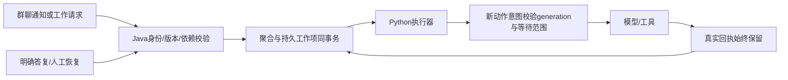

# 验收问题修改与反馈

日期：2026-11-17；版本v1.0。**F01～F06实现已修复，程序及对应开发回归通过，待产品/测试独立复验；不宣布整体产品验收通过。** 原始验收基线`deb48c5`、报告提交`c265efa`，旧失败记录保留于[验收报告](acceptance_20261117.md)。本文件记录修改反馈、实际结果与剩余限制。

## 需求、影响与开发就绪

依据D38/P01～06、DET14、AC02/07/09/16/22/31/32/34，修复F01～F06。业务规则已由原决定及本次修复指令覆盖；下列为这些要求的技术细化，不增加岗位、固定流程、全员暂停或新的人工审批。本会话Codex承担系统设计、前后端开发及整合；交付程序/真实接口验证，模型语义与最终产品重验仍需测试/产品角色判定。

沿用Vue→Java事务网关→纯领域策略/Mapper→PG、Python执行器→网关/模型/工具的单向分层。新增低层任务依赖查询供策略与网关复用，策略不互调，无新框架、队列或外部基础设施。关键技术事实已核实：聚合FOR UPDATE串行命令、PG工作项与外部意图独立持久化，支持在现有事务内补队、校验版本和依赖。无影响开工的未决业务取舍。

| 子任务 | 契约/实现边界 | 开发前预期与验证 |
| --- | --- | --- |
| R01：F01/F02调度与决定 | 任务调度generation与定义revision分开。工作项固定generation；旧代工作只能回存已发出动作结果，不能再派发。恢复在同一事务补齐queued任务缺少的工作项；同任务不并发执行、不重复入队。决定绑定原任务revision，取消/改派后失效，客户端可传expectedRevision防陈旧答复 | 暂停中答复再恢复可claim一次；重复恢复不重复；取消/改派/陈旧评估拒绝；未知外部动作不自动重放 |
| R02：F06等待范围与通信 | related子任务默认依赖来源任务，dependsOnTaskIds可明确列出同run依赖，[]表示事先声明的独立工作；旧数据回退parentTaskId。开放问题阻断本任务及依赖后继，当前有效上级评估任务豁免其正在评估的问题。requiresResponse=false保留@收件但不派工，true维持工作请求；无此字段兼容旧调用。不能从已阻断任务新建“独立”工作绕过等待 | 原任务/相关后继无新模型意图，评估路径和独立兄弟继续；答复只恢复适用后继，人工暂停仍保留；通知不造任务，重复请求幂等 |
| R03：F03文档 | project.save仍仅人；员工仅能在自身有效工作任务所关联项目归档/修订文档，版本CAS、作者/任务/工作来源保留。增加archive_document模型工具，不扩大知识/组织写权 | 本项目新建/修订通过，跨项目/跨队/冒用任务及过期revision拒绝；模型工具映射与真实持久来源正确 |
| R04：F04/F05证据与异常 | 核查subjectRevision必须为正整数且在产物当前/历史中存在；类型仍model-assessment。逐级选上级均检查存在、归属、禁用与循环，失效回到用户并记录具体配置异常 | v999/零/负/小数拒绝，历史版本可核查；禁用/缺失/更高层失效产生带ID和原因的@人通知 |
| R05：前端契约与交接 | 显示决定失效、配置异常和依赖等待；提交编辑开始时的决定版本；通知/请求处理可区分；按版本展示核查，旧/非法证据不冒充当前通过 | 纯函数Red→Green，typecheck/build，真实桌面/390px联调、暂停恢复/旧决定拒绝及通知无派工 |

存量兼容：新增JSON字段有默认值，不改旧历史快照或删除任务。旧工作项generation默认为1；旧决定缺taskRevision仍检查原任务阻断状态、decisionId和取消/替换事实。不自动恢复历史needs_reconciliation、不重发未知请求。新增客户端字段向后兼容，模型工具由新执行器提供；部署时先停止新领取、等在途请求结束，再更换网关/执行器。本地测试用独立库；旧验收事实留存。

## 实施与验证反馈

实际开发和集成约20:51～21:34（北京时间）。被测修复工作树基于c265efa，生产源码哈希及脱敏结果在[结构化修复证据](acceptance_fix_evidence_20261117.json)，提交号由本文件Git历史定位。原验收使用的代码和旧证据文件未覆盖。最终检查另补“引用已完成工作继续提问”回归：保留原任务completed，新建关联任务、恢复该run的active并保留原资源额度；不允许取消任务或未决事项因此绕过阻断。明确需要处理的用户引用系统任务消息按原任务员工路由，保留显式通知语义；原任务仍completed，新任务queued且可领取，原run资源额度不重置。该兼容修正亦先Red后Green。

| 缺陷 | 根因与已做修改 | 实际验证与当前状态 |
| --- | --- | --- |
| F01 暂停中答复后恢复无工作 | 旧逻辑只恢复paused job，漏掉已结束job对应的queued任务。TeamService在聚合事务内补缺队，Mapper按当前generation检查已有工作；新旧调度隔离，旧执行不能改新任务，旧回执仍保留 | 原B02通过；真实PG验证暂停不派发、恢复可领取、重复恢复无重复、旧执行在途时新代次不并发、真实旧回执保存。**开发回归通过，待复验** |
| F02 旧决定复活已取消任务 | RuntimePolicy.respond绑定原任务revision/阻断状态/decisionId，响应可带expectedRevision；取消/改派令问题superseded。前端保存编辑起始revision，失效决定不显示已应用，不提供提交表单 | 原B03现在409、任务保持cancelled且无新工作；新增取消/改派/过期答复程序用例；R-C10桌面实际展示“已失效，未应用”。**开发回归通过，待复验** |
| F03 员工不能归档项目文档 | document.save从项目管理权限中分离，校验当前执行任务、员工、团队和工作项目；作者/任务/运行/工作项进入文档版本，修订CAS。project.save/知识/组织权限不扩大；Python增加archive_document | 原A05通过；新增本项目修订、越项目/越权配置/过期版本拒绝；真实模型3次调用完成文档归档、产物和complete，文档v1作者employee、taskId正确。**开发回归及真实工具联调通过，待业务复验** |
| F04 核查不存在版本 | RuntimePolicy校验正整数和实际版本存在；前端当前区只取本版核查，历史意见按真实历史版本展示，旧非法引用不算当前通过 | 原B05现在409；程序用例999/0/-1/1.5拒绝、合法历史可用；R-C11验证v1通过不进入v2当前区域，历史仍可展开。**开发回归通过，待复验** |
| F05 上级失效静默回退 | 每层nextSuperior统一检查缺失、禁用、团队与循环，回到人时写入configurationError/异常记录和带具体ID/原因的群聊通知；前端直接展示异常 | 原B06通过；禁用/不存在的上级程序用例；R-C12真实HTTP+GUI及390px截图显示具体失效员工ID、已禁用及转用户原因。**开发回归通过，待复验** |
| F06 等待人工仍继续同事项调用 | TaskFlow建立因果依赖等待；上级当前有效评估分支及其协作豁免，升级后也等待，独立分支继续。新动作意图与Worker命令服务端检查；requiresResponse=false通知保留@收件不建任务，新模型工具显式选择通知/工作请求 | 真实PG验证相关任务不能发model意图、独立任务可发；纯领域验证上级可委派评估、再次升级后协作也等待；R-C09实际@通知不新增task。真实模型待决案例仅1任务/1问题、2次调用，109.31秒观察窗口calls保持2、无新派工。**程序及限定真实联调通过，待广泛质量复验** |

### 测试与环境记录

| 层次 | 实际范围、命令及结果 |
| --- | --- |
| 程序基线与TDD | 修改前Python15、前端4、Java纯领域19通过。新增Java七条原缺陷用例出现6个断言失败/1个原403错误；真实PG新增2条分别复现丢队和依赖仍发模型；Python新增工具映射用例失败；前端新增两个状态/版本展示函数用例失败。随后实现、增加评估协作边界Red→Green和在途旧代次回执保护用例 |
| 最终Java | Java21 Maven容器，`GILL_TEAM_DB_TEST=1`、独立数据库gill_team_repair_20261117，`mvn -o -q -Dtest=TeamEngineTest,AcceptanceRepairTest,TeamPersistenceTest test`：19+9+7=**35通过、0跳过**，含真实PG7项。未运行无关旧系统全集 |
| 最终Python | `agent/.venv/bin/python -m unittest discover -s agent/tests -v`：**16通过**；只验证协议/调用/控制程序契约，不给模型文案打分 |
| 最终前端 | Node24.11.0，`npm test`：**6通过**；`npm run typecheck`及`npm run build`成功 |
| API复现 | 新独立账户、实际JWT+内部Worker身份、HTTP+PG，原api-cases及control-cases：**11/11通过**。Worker协议由脚本驱动，不称真实模型 |
| GUI | 真实Chrome、1440×1040及390×844；原7个管理场景+通知不派工/失效决定/版本证据/上级异常/已完成工作续接：**12/12有效回归通过**，无浏览器未处理异常；截图`gui-test-screenshots/v20261117-repair-*`。树为HTML5事件和非拖拽路径，不声称物理拖动通过 |
| 构建与本地运行 | `docker compose build web agentd`及`up -d web agentd`已完成。切换前主库无queued/running团队工作；未改用户配置或业务资料。最终主web与18080验收实例同一镜像`6bb6c793…a00d4`，agentd镜像`2d095b6d…d66cf`；主站8080 HTTP200。本轮未增加DDL迁移，外部在途未知不自动恢复 |

测试设施问题另记：最初Java新测试用var复合声明导致编译失败，修正测试语法后才记录有效行为Red；R-C09首轮选择器字符串引号错误，首次失败保留，修正设施并换新账户后11条通过；不把设施修正当作产品修复。异常截图先只落在页面上方，随后只读滚动到实际异常消息补拍，没有领取工作或修改状态。新增续接GUI早期尝试在重载后未取得团队入口，未捕获HTTP响应，不能确定是否由就绪时序或账号60/min限流引起；保留失败并增加就绪等待、分组节奏和独立账号。之后实际复现requiresResponse=true引用系统完成消息却没有接收者：该程序路由缺口另经Red→Green修复，不能将它计为设施错误。

### 真实模型工具联调及剩余事项

模型仍为原配置glm-4.6，关闭SDK隐式重试；只用合成输入，不创建云沙箱。新账户，纠错/待决各8次/600秒、模板迭代4次/600秒、归档4次/600秒；每例首轮有效结果保留，未追加额度或重跑取最好结果。

错误原稿v1由协议设施预置用于故障注入，seed任务已stopped且0次模型调用，不计作模型产出或有效工作闭环；实际修正v2及核查才来自本轮模型。原案例业务Prompt保持不变，只使用修复后的基础工具契约。模型联调在web镜像ea9cafff…b20ea执行；之后仅补已完成引用回复的兼容分支，最终镜像6bb6c793…a00d4重跑程序/API/GUI，未重跑自然语言输出或挑选结果，两个构建关系记录在证据中。

| 场景 | 实际结果 | 判断边界 |
| --- | --- | --- |
| 原“先复核、等用户决定”流程 | run a0eb6361-4074-4469-87b8-69d3e83127dd，2次调用、原稿v1未改、1个open决定、1个工作任务；从UTC13:15:24到13:17:13累计109.31秒仍2次调用 | F06限定样例的等待/无新派工契约成立；仍未作用户决定，不伪报任务完成 |
| 真实项目文档归档 | run aaafa224-322e-4e78-99c4-64cdaeef6e70，3次调用，文档“归档联调记录”v1、来源任务46a3fc04-8097-4437-8a30-e78c43a6c329、作者employee；run/task completed | F03工具到持久数据闭环成立；文档明确合成资料，不证明真实业务内容正确 |
| 模板自迭代回归 | run 9bbadbe8-88e3-4a54-a185-5fa913a763f3，3次调用，模板v2、改进产物、run/task completed | 保护原能力的限定联调，不证明知识语义泄漏防护或迭代收益 |
| 原“发现错误→修正→复核”流程 | run 7a767fdb-4555-4685-ad4e-a3f96b820675，8次调用；真实95→90、产物v2及v2复核记录成立，3个工作任务；复核任务尚未完成报告/结束，达到原额度后run waiting并@人 | **整体场景仍未通过**。没有旧例继续互相确认派生更多任务，但8次上限内未收尾；保持成果和资源拦截，不临时扩额、改业务Prompt或代模型补交付 |

下一步交接：测试/产品按新整合提交复验F01～F06，重点补决定适用范围、真实断连恢复、忙碌/失效收件及更广泛模型协作质量。原GitHub云端连接超时未在本次修复，也未将主机连通当作云端已恢复；真实改码/并行版本/合并及原AC矩阵其他缺口仍待验证。通知/工作选择由模型承担，误选工作请求及无进展讨论仍由监督与配置上限兜底，本轮不保证任意流程自然收敛。大规模聚合/历史及轮询开销未压测；新增就绪补队只在短事务内查询，不据此承诺任意规模。

收尾：独立模型Worker在无queued/running任务后停止，不替用户回答待决事项；测试数据和脱敏事实保留，临时凭据删除、18080验收实例停止。主应用保留新镜像运行。**实现修复、开发回归、模型业务质量验收、整体产品验收为不同状态；本次不代用户接受残余风险。**
