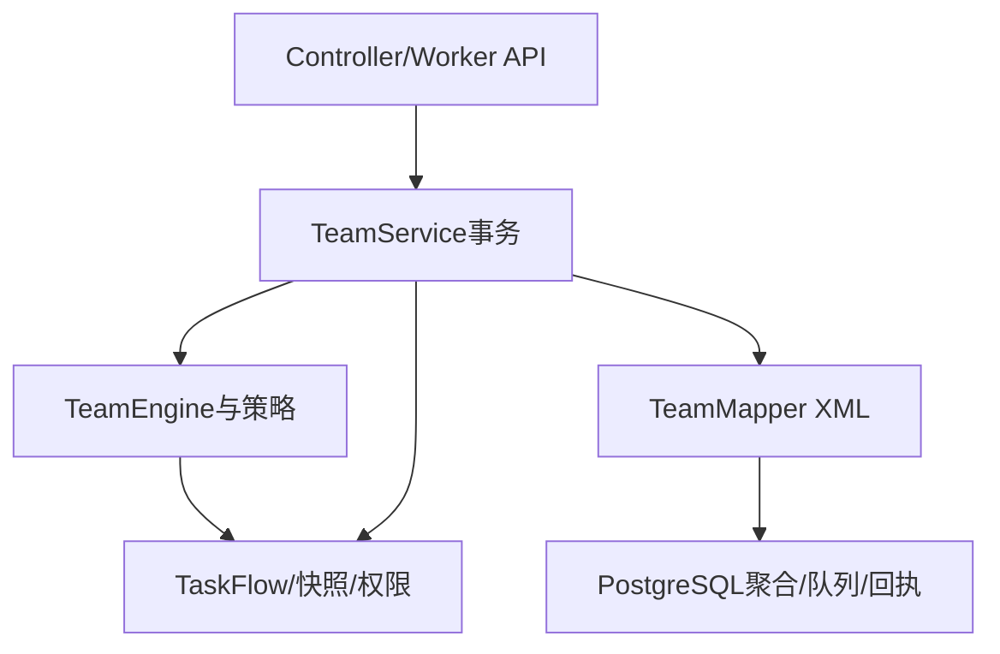

# Java 网关

新团队接口按 `TeamController / TeamWorkerController → TeamService → TeamEngine → 下层策略` 编排；`TeamService → TeamMapper → TeamWorkspaceRow` 持久化。纯策略互不形成循环，公共任务快照、权限与依赖下沉到 `TaskAdoption / TaskAccess / TaskFlow / TeamData`。

TaskFlow 查询因果依赖、派工许可及评估豁免，记录等待和旧决定失效。TeamService 在聚合锁内补齐已就绪任务。generation 隔离新旧调度，PG 领取检查代次、同任务并发和未决动作。群聊通知只保留投递，核查单独调度，正式派工校验同一工作许可。文档只允许写入当前关联项目。



`V2__digital_teams.sql` 新增独立工作区、幂等请求、事件、持久工作项和动作回执，兼容 V1 数据。定义对象在每用户 JSONB 聚合中；租约和执行意图是独立关系表。所有外部模型、沙箱、MinIO 等待都在 Java 事务之外。

```sh
mvn test
mvn package
```

需要 Java 21。`TeamEngineTest`和`AcceptanceRepairTest`为纯领域测试；`TeamPersistenceTest`只有在`GILL_TEAM_DB_TEST=1`时运行，必须设置`DB_URL`指向独立测试数据库及相应凭据，测试通过真实PG验证事务、租约、暂停恢复、旧代次及依赖等待。禁止指向业务数据库。

接口与状态见[实现契约](../docs/features/digital-employee-team/implementation.md)，前端见 [frontend/README.md](frontend/README.md)，规范见 [AGENT.md](AGENT.md)。
