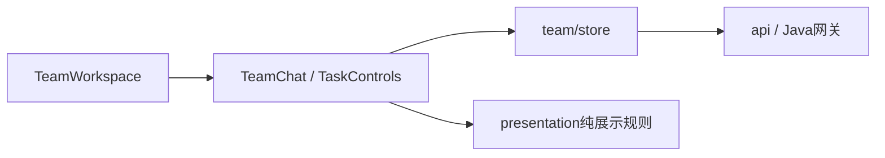

# Vue 团队工作台

`App.vue` 在认证后进入 `team/TeamWorkspace.vue`，`#/legacy` 保留旧会话。新团队状态只由 `team/store.ts` 调用真实团队 API；不导入静态原型数据。读请求以工作区 revision 与请求序号过滤过期结果，表单保存携带打开时的定义版本。

`TeamChat` 是对话主区，`TaskControls` 提供任务阻断、恢复、改派与人工核实；右侧为团队摘要。`TeamDirectory` 首页只展示团队简介，详情管理组织树和员工；项目库在团队详情。`TemplateLibrary` 支持多轮生成草稿、编辑和明确保存；`KnowledgeLibrary` 管理 Agent 只读的知识版本。

聊天可选择是否需要员工处理；只通知时保留@但不派发。决定编辑保留开始时的revision，过期提交交服务端拒绝且不丢输入；superseded明确显示“已失效，未应用”。当前产物只展示当前版本的核查，历史评审在对应历史版本下展开。配置异常仍在同一群聊显示，不增加主导航。



```sh
npm ci
npm test
npm run typecheck
npm run build
```

构建输出到 Java 的 `src/main/resources/static`，不提交产物。页面每 4 秒拉取持久工作区，另有持久事件游标 API；当前并非团队 WS 流式页面。桌面和 390px 手机均需实测。选择器程序测试不替代浏览器及模型语义验收，详见[验证记录](../../docs/features/digital-employee-team/verification.md)。
