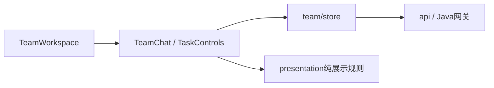

# Vue 团队工作台

`App.vue` 在认证后进入 `team/TeamWorkspace.vue`，`#/legacy` 保留旧会话。新团队状态只由 `team/store.ts` 调用真实团队 API；不导入静态原型数据。读请求以工作区 revision 与请求序号过滤过期结果，表单保存携带打开时的定义版本。

`TeamChat` 是对话主区，`TaskControls` 提供任务阻断、恢复、改派与人工核实；右侧为团队摘要。`TeamDirectory` 首页只展示团队简介，详情管理组织树和员工；项目库在团队详情。`TemplateLibrary` 支持多轮生成草稿、编辑和明确保存；`KnowledgeLibrary` 管理 Agent 只读的知识版本。

模板首页展示已有模板或创建引导。创建时可选择对话、导入文件夹或手动填写。同一模板支持连续导入多个 Skill 目录，也支持一次导入目录集合。单个 Skill 保存到 `skills/<目录名>/`，包含原有的入口文件与附件。编辑区按 Skill 展开各自的文件，可以设置文件用途后保存为模板版本。

聊天提供「仅通知」「请同事核查」「正式派工」。引用和直接选择 @员工默认使用通知；明确选择正式派工后，新目标可勾选「后续派工需我许可」。群聊决定卡可允许后续派工或保持限制，补充意见时保持待决。决定编辑保留开始时的 revision，过期提交由服务端拒绝且保留输入，superseded 显示「已失效，未应用」。当前产物展示当前版本的核查，历史评审在对应版本下展开。



```sh
npm ci
npm test
npm run typecheck
npm run build
```

构建输出到 Java 的 `src/main/resources/static`，不提交产物。页面每 4 秒拉取持久工作区，另有持久事件游标 API；当前并非团队 WS 流式页面。桌面和 390px 手机均需实测。选择器程序测试不替代浏览器及模型语义验收，详见[验证记录](../../docs/features/digital-employee-team/verification.md)。

决策详情可以查看关联任务、尝试、候选选项与实际意见。任务详情展示冻结配置与执行器实际读到的知识版本。拉取失败后，工作台保留最近成功读取时间并显示忙闲未知，成功刷新后重新显示观察结果。
